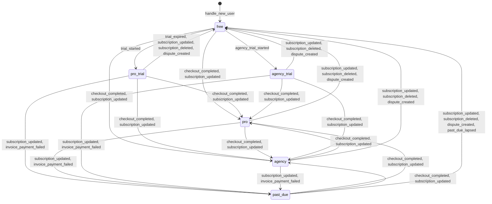

# SPEC 01: accounts, seats and entitlement (CC-01, CC-02)

> Generated by `pnpm --filter @crawlmouse/web exec tsx __tests__/helpers/write-01-accounts-spec.ts`. Do not edit it by hand: `apps/web/__tests__/v2-01-accounts-spec.test.ts` fails when this file differs from what the generator writes.

Migration 001 (`infra/supabase/migrations/20261101000001_v2_001_entitlement_tables.sql`) adds the
entitlement tables of ARCH-2 §2.4 and extends the sign-up trigger. `apps/web/lib/entitlement-v2.ts`
holds the gates and `apps/web/lib/billing/state-machine.ts` the transitions. None of it is read by
a live route yet: v1 entitlement (`users.pro_until`, `lib/pro.ts`, `lib/entitlement.ts`) is
unchanged.

## Sign-up

`handle_new_user` runs on every `auth.users` insert. It inserts the `users` row as v1 does, then, in
the same transaction and only when that row has no default account: a personal account in state
`free` with the Free limits and a one-entry history, the active `owner` seat for the user, and
`users.default_account_id`. If any of these fails, the sign-up fails. The account starts `free`;
a trial is the `trial_started` event, applied once CC-04's ledger rules allow it. The tests are the
`handle_new_user: …` group in `apps/web/__tests__/v2-001-entitlement-tables.test.ts`.

## Tables

### `accounts`

| Column                    | Type                     | Null | Default             |
| ------------------------- | ------------------------ | ---- | ------------------- |
| `id`                      | uuid                     | no   | `gen_random_uuid()` |
| `kind`                    | text                     | no   |                     |
| `name`                    | text                     | yes  |                     |
| `state`                   | text                     | no   |                     |
| `tier`                    | text                     | no   | `'free'::text`      |
| `past_due_tier`           | text                     | yes  |                     |
| `past_due_since`          | timestamp with time zone | yes  |                     |
| `trial_variant`           | text                     | yes  |                     |
| `disputed_at`             | timestamp with time zone | yes  |                     |
| `trial_ends_at`           | timestamp with time zone | yes  |                     |
| `trial_used_at`           | timestamp with time zone | yes  |                     |
| `stripe_customer_id`      | text                     | yes  |                     |
| `timezone`                | text                     | no   | `'UTC'::text`       |
| `seat_limit`              | integer                  | no   |                     |
| `site_limit`              | integer                  | no   |                     |
| `competitor_limit`        | integer                  | no   | `0`                 |
| `card_last4`              | text                     | yes  |                     |
| `email_change_notes`      | boolean                  | no   | `true`              |
| `email_trial_reminder`    | boolean                  | no   | `true`              |
| `state_history`           | jsonb                    | no   |                     |
| `entitlement_version`     | integer                  | no   | `0`                 |
| `current_subscription_id` | text                     | yes  |                     |
| `entitlement_changed_at`  | timestamp with time zone | yes  |                     |
| `last_active_at`          | timestamp with time zone | yes  |                     |
| `created_at`              | timestamp with time zone | no   | `now()`             |
| `updated_at`              | timestamp with time zone | no   | `now()`             |
| `deleted_at`              | timestamp with time zone | yes  |                     |

Constraints:

- `accounts_card_last4_check`: `CHECK ((card_last4 ~ '^[0-9]{4}$'::text))`
- `accounts_competitor_limit_check`: `CHECK ((competitor_limit >= 0))`
- `accounts_current_subscription_id_check`: `CHECK ((current_subscription_id ~ '^sub_'::text))`
- `accounts_kind_check`: `CHECK ((kind = ANY (ARRAY['personal'::text, 'agency'::text])))`
- `accounts_past_due`: `CHECK ((((state = 'past_due'::text) = (past_due_tier IS NOT NULL)) AND ((state = 'past_due'::text) = (past_due_since IS NOT NULL))))`
- `accounts_past_due_tier_check`: `CHECK ((past_due_tier = ANY (ARRAY['pro'::text, 'agency'::text])))`
- `accounts_pkey`: `PRIMARY KEY (id)`
- `accounts_seat_limit_check`: `CHECK ((seat_limit >= 1))`
- `accounts_site_limit_check`: `CHECK (((site_limit >= 1) AND (site_limit <= 50)))`
- `accounts_state_check`: `CHECK ((state = ANY (ARRAY['free'::text, 'pro_trial'::text, 'pro'::text, 'agency_trial'::text, 'agency'::text, 'past_due'::text])))`
- `accounts_state_history`: `CHECK (COALESCE(
CASE
    WHEN (jsonb_typeof(state_history) = 'array'::text) THEN (((jsonb_array_length(state_history) >= 1) AND (jsonb_array_length(state_history) <= 200)) AND (((state_history -> '-1'::integer) ->> 'state'::text) = state))
    ELSE NULL::boolean
END, false))`
- `accounts_stripe_customer_id_key`: `UNIQUE (stripe_customer_id)`
- `accounts_subscription`: `CHECK (
CASE
    WHEN (state = 'free'::text) THEN true
    WHEN (state = 'pro_trial'::text) THEN ((trial_variant <> 'no_card'::text) = (current_subscription_id IS NOT NULL))
    ELSE (current_subscription_id IS NOT NULL)
END)`
- `accounts_tier_check`: `CHECK ((tier = ANY (ARRAY['free'::text, 'pro'::text, 'agency'::text])))`
- `accounts_tier_matches_state`: `CHECK (COALESCE(
CASE state
    WHEN 'free'::text THEN (tier = 'free'::text)
    WHEN 'pro_trial'::text THEN (tier = 'pro'::text)
    WHEN 'pro'::text THEN (tier = 'pro'::text)
    WHEN 'agency_trial'::text THEN (tier = 'agency'::text)
    WHEN 'agency'::text THEN (tier = 'agency'::text)
    WHEN 'past_due'::text THEN (tier = past_due_tier)
    ELSE NULL::boolean
END, false))`
- `accounts_trial_ends`: `CHECK (((state = ANY (ARRAY['pro_trial'::text, 'agency_trial'::text])) = (trial_ends_at IS NOT NULL)))`
- `accounts_trial_fields`: `CHECK ((((state <> 'pro_trial'::text) OR (trial_variant IS NOT NULL)) AND ((state <> ALL (ARRAY['pro_trial'::text, 'agency_trial'::text])) OR (trial_used_at IS NOT NULL))))`
- `accounts_trial_variant_check`: `CHECK ((trial_variant = ANY (ARRAY['no_card'::text, 'card_required'::text])))`

Indexes:

- `CREATE INDEX accounts_past_due_idx ON public.accounts USING btree (state, past_due_since) WHERE (state = 'past_due'::text)`
- `CREATE UNIQUE INDEX accounts_pkey ON public.accounts USING btree (id)`
- `CREATE INDEX accounts_state_trial_ends_idx ON public.accounts USING btree (state, trial_ends_at)`
- `CREATE UNIQUE INDEX accounts_stripe_customer_id_key ON public.accounts USING btree (stripe_customer_id)`

### `subscriptions`

| Column                 | Type                     | Null | Default        |
| ---------------------- | ------------------------ | ---- | -------------- |
| `id`                   | text                     | no   |                |
| `account_id`           | uuid                     | no   |                |
| `status`               | text                     | no   |                |
| `plan`                 | text                     | no   |                |
| `interval`             | text                     | no   |                |
| `seat_quantity`        | integer                  | no   | `0`            |
| `extra_site_quantity`  | integer                  | no   | `0`            |
| `current_period_end`   | timestamp with time zone | yes  |                |
| `trial_end`            | timestamp with time zone | yes  |                |
| `cancel_at_period_end` | boolean                  | no   | `false`        |
| `canceled_at`          | timestamp with time zone | yes  |                |
| `ended_at`             | timestamp with time zone | yes  |                |
| `price_ids`            | text[]                   | no   | `'{}'::text[]` |
| `last_event_id`        | text                     | yes  |                |
| `last_event_created`   | timestamp with time zone | yes  |                |
| `created_at`           | timestamp with time zone | no   | `now()`        |
| `updated_at`           | timestamp with time zone | no   | `now()`        |

Constraints:

- `subscriptions_account_id_fkey`: `FOREIGN KEY (account_id) REFERENCES accounts(id) ON DELETE CASCADE`
- `subscriptions_extra_site_quantity_check`: `CHECK (((extra_site_quantity >= 0) AND (extra_site_quantity <= 25)))`
- `subscriptions_extras_agency_only`: `CHECK (((plan = 'agency'::text) OR ((seat_quantity = 0) AND (extra_site_quantity = 0))))`
- `subscriptions_id_check`: `CHECK ((id ~ '^sub_'::text))`
- `subscriptions_interval_check`: `CHECK (("interval" = ANY (ARRAY['month'::text, 'year'::text])))`
- `subscriptions_pkey`: `PRIMARY KEY (id)`
- `subscriptions_plan_check`: `CHECK ((plan = ANY (ARRAY['pro'::text, 'agency'::text])))`
- `subscriptions_seat_quantity_check`: `CHECK ((seat_quantity >= 0))`
- `subscriptions_status_check`: `CHECK ((status = ANY (ARRAY['trialing'::text, 'active'::text, 'past_due'::text, 'canceled'::text, 'unpaid'::text, 'incomplete'::text, 'incomplete_expired'::text, 'paused'::text])))`

Indexes:

- `CREATE INDEX subscriptions_account_status_idx ON public.subscriptions USING btree (account_id, status)`
- `CREATE UNIQUE INDEX subscriptions_pkey ON public.subscriptions USING btree (id)`

### `seats`

| Column              | Type                     | Null | Default             |
| ------------------- | ------------------------ | ---- | ------------------- |
| `id`                | uuid                     | no   | `gen_random_uuid()` |
| `account_id`        | uuid                     | no   |                     |
| `user_id`           | uuid                     | yes  |                     |
| `invited_email`     | text                     | no   |                     |
| `name`              | text                     | yes  |                     |
| `role`              | text                     | no   |                     |
| `status`            | text                     | no   |                     |
| `invite_token_hash` | text                     | yes  |                     |
| `alert_channels`    | text[]                   | no   | `'{email}'::text[]` |
| `theme`             | text                     | no   | `'system'::text`    |
| `created_at`        | timestamp with time zone | no   | `now()`             |
| `accepted_at`       | timestamp with time zone | yes  |                     |
| `removed_at`        | timestamp with time zone | yes  |                     |

Constraints:

- `seats_account_id_fkey`: `FOREIGN KEY (account_id) REFERENCES accounts(id) ON DELETE CASCADE`
- `seats_active_is_accepted`: `CHECK (((status <> 'active'::text) OR ((user_id IS NOT NULL) AND (accepted_at IS NOT NULL))))`
- `seats_alert_channels_check`: `CHECK ((alert_channels <@ ARRAY['email'::text, 'slack'::text]))`
- `seats_pkey`: `PRIMARY KEY (id)`
- `seats_removed_at`: `CHECK (((status = 'removed'::text) = (removed_at IS NOT NULL)))`
- `seats_role_check`: `CHECK ((role = ANY (ARRAY['owner'::text, 'account_manager'::text, 'developer'::text])))`
- `seats_status_check`: `CHECK ((status = ANY (ARRAY['invited'::text, 'active'::text, 'removed'::text])))`
- `seats_theme_check`: `CHECK ((theme = ANY (ARRAY['system'::text, 'light'::text, 'dark'::text])))`
- `seats_user_id_fkey`: `FOREIGN KEY (user_id) REFERENCES users(id) ON DELETE CASCADE`

Indexes:

- `CREATE INDEX seats_account_idx ON public.seats USING btree (account_id)`
- `CREATE UNIQUE INDEX seats_account_invited_email_uq ON public.seats USING btree (account_id, lower(invited_email)) WHERE (status = 'invited'::text)`
- `CREATE UNIQUE INDEX seats_account_user_uq ON public.seats USING btree (account_id, user_id) WHERE (user_id IS NOT NULL)`
- `CREATE UNIQUE INDEX seats_one_active_owner_uq ON public.seats USING btree (account_id) WHERE ((role = 'owner'::text) AND (status = 'active'::text))`
- `CREATE UNIQUE INDEX seats_pkey ON public.seats USING btree (id)`
- `CREATE INDEX seats_user_status_idx ON public.seats USING btree (user_id, status)`

### `agency_brands`

| Column                         | Type                     | Null | Default               |
| ------------------------------ | ------------------------ | ---- | --------------------- |
| `account_id`                   | uuid                     | no   |                       |
| `agency_name`                  | text                     | no   |                       |
| `logo_path`                    | text                     | yes  |                       |
| `accent_hex`                   | text                     | yes  |                       |
| `portal_domain`                | text                     | yes  |                       |
| `portal_domain_status`         | text                     | no   | `'unverified'::text`  |
| `portal_txt_token`             | text                     | yes  |                       |
| `portal_txt_verified_at`       | timestamp with time zone | yes  |                       |
| `portal_cname_found`           | boolean                  | yes  |                       |
| `portal_certificate_issued_at` | timestamp with time zone | yes  |                       |
| `portal_slug`                  | text                     | yes  |                       |
| `vercel_domain_added_at`       | timestamp with time zone | yes  |                       |
| `sender_domain`                | text                     | yes  |                       |
| `sender_from`                  | text                     | yes  |                       |
| `resend_domain_id`             | text                     | yes  |                       |
| `sender_domain_status`         | text                     | no   | `'not_started'::text` |
| `spf_passes`                   | boolean                  | yes  |                       |
| `dkim_passes`                  | boolean                  | yes  |                       |
| `dmarc_policy`                 | text                     | yes  |                       |
| `open_tracking_default`        | boolean                  | no   | `false`               |
| `postal_address`               | text                     | yes  |                       |
| `created_at`                   | timestamp with time zone | no   | `now()`               |
| `updated_at`                   | timestamp with time zone | no   | `now()`               |

Constraints:

- `agency_brands_accent_hex_check`: `CHECK ((accent_hex ~ '^#[0-9A-Fa-f]{6}$'::text))`
- `agency_brands_account_id_fkey`: `FOREIGN KEY (account_id) REFERENCES accounts(id) ON DELETE CASCADE`
- `agency_brands_agency_name_check`: `CHECK ((length(agency_name) >= 1))`
- `agency_brands_dns`: `CHECK (((portal_domain IS NULL) = (portal_cname_found IS NULL)))`
- `agency_brands_email_auth`: `CHECK ((((sender_from IS NULL) = (spf_passes IS NULL)) AND ((sender_from IS NULL) = (dkim_passes IS NULL))))`
- `agency_brands_pkey`: `PRIMARY KEY (account_id)`
- `agency_brands_portal_domain_check`: `CHECK ((portal_domain = lower(portal_domain)))`
- `agency_brands_portal_domain_key`: `UNIQUE (portal_domain)`
- `agency_brands_portal_domain_status_check`: `CHECK ((portal_domain_status = ANY (ARRAY['unverified'::text, 'txt_verified'::text, 'pending'::text, 'verified'::text, 'error'::text])))`
- `agency_brands_portal_slug_key`: `UNIQUE (portal_slug)`
- `agency_brands_postal`: `CHECK (((sender_from IS NULL) OR (postal_address IS NOT NULL)))`
- `agency_brands_postal_address_check`: `CHECK ((length(postal_address) >= 1))`
- `agency_brands_sender_domain_status_check`: `CHECK ((sender_domain_status = ANY (ARRAY['not_started'::text, 'pending'::text, 'verified'::text, 'failed'::text])))`

Indexes:

- `CREATE UNIQUE INDEX agency_brands_pkey ON public.agency_brands USING btree (account_id)`
- `CREATE UNIQUE INDEX agency_brands_portal_domain_key ON public.agency_brands USING btree (portal_domain)`
- `CREATE UNIQUE INDEX agency_brands_portal_slug_key ON public.agency_brands USING btree (portal_slug)`

### `trial_ledger`

| Column       | Type                     | Null | Default             |
| ------------ | ------------------------ | ---- | ------------------- |
| `id`         | uuid                     | no   | `gen_random_uuid()` |
| `kind`       | text                     | no   |                     |
| `value_hash` | text                     | no   |                     |
| `account_id` | uuid                     | yes  |                     |
| `trial_kind` | text                     | no   |                     |
| `created_at` | timestamp with time zone | no   | `now()`             |

Constraints:

- `trial_ledger_account_id_fkey`: `FOREIGN KEY (account_id) REFERENCES accounts(id) ON DELETE SET NULL`
- `trial_ledger_kind_check`: `CHECK ((kind = ANY (ARRAY['email'::text, 'hostname'::text, 'card_fingerprint'::text, 'device'::text, 'ip24'::text])))`
- `trial_ledger_pkey`: `PRIMARY KEY (id)`
- `trial_ledger_trial_kind_check`: `CHECK ((trial_kind = ANY (ARRAY['pro'::text, 'agency'::text])))`
- `trial_ledger_value_hash_check`: `CHECK ((value_hash ~ '^[0-9a-f]{64}$'::text))`

Indexes:

- `CREATE INDEX trial_ledger_account_idx ON public.trial_ledger USING btree (account_id)`
- `CREATE INDEX trial_ledger_lookup_idx ON public.trial_ledger USING btree (kind, value_hash, created_at DESC)`
- `CREATE UNIQUE INDEX trial_ledger_pkey ON public.trial_ledger USING btree (id)`

### `users`: the new columns

| Column               | Type | Null | Default |
| -------------------- | ---- | ---- | ------- |
| `email_normalized`   | text | yes  |         |
| `default_account_id` | uuid | yes  |         |

## Grants and policies

Read from the catalog after every migration is applied. `postgres`, the owner, is not listed.

| Table           | RLS | PUBLIC | anon | authenticated                                                           | service_role | Policies                                                                           |
| --------------- | --- | ------ | ---- | ----------------------------------------------------------------------- | ------------ | ---------------------------------------------------------------------------------- |
| `accounts`      | on  | none   | none | SELECT, granted per column, on every column except `stripe_customer_id` | all          | `accounts_member_read`: SELECT to authenticated using `is_member(id)`              |
| `subscriptions` | on  | none   | none | SELECT, granted per column on every column                              | all          | `subscriptions_member_read`: SELECT to authenticated using `is_member(account_id)` |
| `seats`         | on  | none   | none | SELECT, granted per column, on every column except `invite_token_hash`  | all          | `seats_member_read`: SELECT to authenticated using `is_member(account_id)`         |
| `agency_brands` | on  | none   | none | SELECT, granted per column on every column                              | all          | `agency_brands_member_read`: SELECT to authenticated using `is_member(account_id)` |
| `trial_ledger`  | on  | none   | none | none                                                                    | all          | none                                                                               |

### Functions

| Function                                                                                                                                                                                                                                                                                                                                                                                                                                                                                          | Security | search_path          | EXECUTE (anon, authenticated, service_role) |
| ------------------------------------------------------------------------------------------------------------------------------------------------------------------------------------------------------------------------------------------------------------------------------------------------------------------------------------------------------------------------------------------------------------------------------------------------------------------------------------------------- | -------- | -------------------- | ------------------------------------------- |
| `apply_entitlement_transition(p_account_id uuid, p_expected_version integer, p_state text, p_tier text, p_past_due_tier text, p_past_due_since timestamp with time zone, p_trial_variant text, p_trial_ends_at timestamp with time zone, p_trial_used_at timestamp with time zone, p_disputed_at timestamp with time zone, p_seat_limit integer, p_site_limit integer, p_competitor_limit integer, p_at timestamp with time zone, p_subscription_id text, p_changed_at timestamp with time zone)` | definer  | `public, pg_catalog` | service_role                                |
| `assert_entitlement_version(p_account_id uuid, p_expected_version integer)`                                                                                                                                                                                                                                                                                                                                                                                                                       | definer  | `public, pg_catalog` | service_role                                |
| `handle_new_user()`                                                                                                                                                                                                                                                                                                                                                                                                                                                                               | definer  | `public, pg_catalog` | service_role                                |
| `is_member(p_account uuid)`                                                                                                                                                                                                                                                                                                                                                                                                                                                                       | definer  | `public, pg_catalog` | authenticated, service_role                 |
| `member_role(p_account uuid)`                                                                                                                                                                                                                                                                                                                                                                                                                                                                     | definer  | `public, pg_catalog` | authenticated, service_role                 |

## States and transitions

`next(snapshot, event)` in `apps/web/lib/billing/state-machine.ts` is pure. The diagram and the
table are its output for one fixture per state: `free` follows no subscription and has not been changed by a Stripe event; `free, lapsed` follows `sub_current` and was last changed by one at 2026-11-01T00:00:00.000Z; `pro_trial (no card)` follows no subscription and has not been changed by a Stripe event; `pro_trial (card)` follows `sub_current` and was last changed by one at 2026-11-01T00:00:00.000Z; `pro` follows `sub_current` and was last changed by one at 2026-11-01T00:00:00.000Z; `agency_trial` follows `sub_current` and was last changed by one at 2026-11-01T00:00:00.000Z; `agency` follows `sub_current` and was last changed by one at 2026-11-01T00:00:00.000Z; `past_due` follows `sub_current` and was last changed by one at 2026-11-01T00:00:00.000Z. Events that name `sub_other`: trial_started (card, new subscription); agency_trial_started (new subscription); checkout_completed (pro, new subscription); checkout_completed (agency, new subscription); checkout_completed (pro, stamped before the last change); checkout_completed (pro, its subscription already canceled); subscription_updated canceled, another subscription; subscription_deleted, another subscription. Events that name `sub_current`: trial_will_end; subscription_updated active, pro; subscription_updated active, agency; subscription_updated active, agency, 2 extra seats; subscription_updated active, pro, cancel_at_period_end; subscription_updated active, pro, stamped before the last change; subscription_updated past_due; subscription_updated canceled; subscription_updated unpaid; subscription_updated paused; subscription_deleted; invoice_payment_failed. The others name no subscription. Events are stamped 2026-11-15T00:00:00.000Z or 2026-10-31T00:00:00.000Z.
A cell holds the next state; `-` means the event is ignored in that state.
`apps/web/lib/billing/state-machine.test.ts` checks the transitions row by row against a
hand-written table, and `state-machine.property.test.ts` checks properties over generated
event sequences.



| Event                                                            | free         | free, lapsed | pro_trial (no card) | pro_trial (card) | pro      | agency_trial | agency   | past_due |
| ---------------------------------------------------------------- | ------------ | ------------ | ------------------- | ---------------- | -------- | ------------ | -------- | -------- |
| trial_started (no card)                                          | pro_trial    | -            | -                   | -                | -        | -            | -        | -        |
| trial_started (card, new subscription)                           | pro_trial    | -            | -                   | -                | -        | -            | -        | -        |
| agency_trial_started (new subscription)                          | agency_trial | -            | -                   | -                | -        | -            | -        | -        |
| trial_reminder_due                                               | -            | -            | pro_trial           | -                | -        | -            | -        | -        |
| trial_will_end                                                   | -            | -            | -                   | pro_trial        | -        | agency_trial | -        | -        |
| trial_expired                                                    | -            | -            | free                | -                | -        | -            | -        | -        |
| checkout_completed (pro, new subscription)                       | pro          | pro          | pro                 | pro              | pro      | pro          | pro      | pro      |
| checkout_completed (agency, new subscription)                    | agency       | agency       | agency              | agency           | agency   | agency       | agency   | agency   |
| checkout_completed (pro, stamped before the last change)         | pro          | -            | pro                 | -                | -        | -            | -        | -        |
| checkout_completed (pro, its subscription already canceled)      | -            | -            | -                   | -                | -        | -            | -        | -        |
| subscription_updated active, pro                                 | -            | pro          | -                   | pro              | -        | pro          | pro      | pro      |
| subscription_updated active, agency                              | -            | agency       | -                   | agency           | agency   | agency       | -        | agency   |
| subscription_updated active, agency, 2 extra seats               | -            | agency       | -                   | agency           | agency   | agency       | agency   | agency   |
| subscription_updated active, pro, cancel_at_period_end           | -            | pro          | -                   | pro              | -        | pro          | pro      | pro      |
| subscription_updated active, pro, stamped before the last change | -            | -            | -                   | -                | -        | -            | -        | -        |
| subscription_updated past_due                                    | -            | free         | -                   | past_due         | past_due | past_due     | past_due | past_due |
| subscription_updated canceled                                    | -            | free         | -                   | free             | free     | free         | free     | free     |
| subscription_updated unpaid                                      | -            | free         | -                   | free             | free     | free         | free     | free     |
| subscription_updated paused                                      | -            | free         | -                   | free             | free     | free         | free     | free     |
| subscription_updated canceled, another subscription              | -            | -            | -                   | -                | -        | -            | -        | -        |
| subscription_deleted                                             | -            | free         | -                   | free             | free     | free         | free     | free     |
| subscription_deleted, another subscription                       | -            | -            | -                   | -                | -        | -            | -        | -        |
| invoice_payment_failed                                           | -            | free         | -                   | past_due         | past_due | past_due     | past_due | past_due |
| dispute_created                                                  | free         | free         | free                | free             | free     | free         | free     | free     |
| past_due_lapsed                                                  | -            | -            | -                   | -                | -        | -            | -        | free     |
| recorded_only (invoice.paid)                                     | -            | -            | -                   | -                | -        | -            | -        | -        |

Two rules decide whether a Stripe event may change an account. **Which subscription:** a
checkout, a card trial start or an agency trial start makes the subscription it names the
current one; every other
subscription event applies only to the current subscription, and a dispute applies whatever it
names. **How old:** an event that grants or restores a plan is ignored when it is stamped at least
one whole second before the last change a Stripe event made (Stripe floors `created` to the
second). Changes on our own clock (a no-card trial, its expiry, the lapse sweep) do not count. An
event that takes a plan away applies whatever its age, and one that changes nothing else still
records its time. **Still live:** a checkout, a card trial start or an agency trial start
carries its subscription’s status as CC-03 retrieves it, and grants only while that subscription
is `active` (a checkout) or `trialing` (a trial start). `invoice.paid` is recorded only: past_due
ends on the subscription's own `active` update. `unpaid` and `paused` keep the subscription, so
its later `active` restores the plan; `canceled` and `incomplete_expired` end it.

Effects. `relimit` when the limits change, and it removes the newest active non-owner seats
beyond the seat limit. `pause_others` on a move from a paid tier to Free: the oldest primary site keeps a
monthly check and the others pause. `pause_over_limit` or `resume` when the site limit falls or
rises otherwise. `entitlement.changed` when the state or the limits change. Event-specific:
`trial.started` and `trial.converted` for the no-card trial, the trial reminder email, and a
founder alert on a dispute.

### Stripe events (ARCH-2 §3.3)

CC-03 parses each webhook into the normalised event; this module does not read Stripe payloads.

| Stripe event                           | Normalised event         |
| -------------------------------------- | ------------------------ |
| `checkout.session.completed`           | `checkout_completed`     |
| `customer.subscription.created`        | `recorded_only`          |
| `customer.subscription.updated`        | `subscription_updated`   |
| `customer.subscription.deleted`        | `subscription_deleted`   |
| `customer.subscription.trial_will_end` | `trial_will_end`         |
| `invoice.paid`                         | `recorded_only`          |
| `invoice.payment_failed`               | `invoice_payment_failed` |
| `setup_intent.succeeded`               | `recorded_only`          |
| `charge.dispute.created`               | `dispute_created`        |
| `charge.refunded`                      | `recorded_only`          |
| `customer.updated`                     | `recorded_only`          |

## Gates

`GATES` in `apps/web/lib/entitlement-v2.ts`. `gatesFor(account, now)` reads them for the tier
`effectiveTier()` returns: the `tier` column, except that a `past_due` account keeps
`past_due_tier` for 7 days from `past_due_since` and is Free from then on, and a no-card trial
is Free from `trial_ends_at` whether or not `trial_expired` was applied.

| Gate                                                               | free                    | pro (incl. trial) | agency (incl. trial) | Source                                |
| ------------------------------------------------------------------ | ----------------------- | ----------------- | -------------------- | ------------------------------------- |
| Primary sites in the plan                                          | 1                       | 5                 | 25                   | ARCH-2 §3.1                           |
| Primary sites with paid extras                                     | 1                       | 5                 | 50                   | ARCH-2 §3.1                           |
| Seats in the plan (Agency adds $12 seats)                          | 1                       | 2                 | 5                    | ARCH-2 §3.1                           |
| Scheduled checks                                                   | monthly_first_site_only | weekly            | weekly               | ARCH-2 §3.1                           |
| Fixes visible                                                      | 3                       | all               | all                  | ARCH-2 §3.1                           |
| Fix packets                                                        | visible_fixes_only      | all               | all                  | ARCH-2 §3.1                           |
| Competitors per site                                               | 0                       | 1                 | 3                    | ARCH-2 §3.1                           |
| Exports (PDF, CSV, JSON)                                           | no                      | yes               | yes                  | ARCH-2 §3.1                           |
| Slack                                                              | no                      | yes               | yes                  | ARCH-2 §3.1                           |
| Staging and deploy hooks                                           | no                      | yes               | yes                  | ARCH-2 §3.1                           |
| Brand, sender domain, client report page, scheduled client reports | no                      | no                | yes                  | ARCH-2 §3.1                           |
| Pages per check                                                    | 500                     | 2000              | 2000                 | ARCH-2 §3.1; paid value pending CC-39 |
| Full renders per month                                             | 0                       | 10                | 30                   | ARCH-2 §3.1                           |
| Read-only API                                                      | no                      | yes               | yes                  | ARCH-2 §3.1                           |
| Search Console overlay                                             | no                      | yes               | yes                  | ARCH-2 §3.1                           |
| Observed crawler activity                                          | no                      | yes               | yes                  | ARCH-2 §3.1                           |
| Checks per site per day, per eTLD+1 across accounts                | 3                       | 12                | 12                   | DECISION-LOG J9                       |

## Where this differs from the design documents

The contract (`packages/types/src/v2`) wins where it and a document disagree.

- Seat roles are `owner`, `account_manager`, `developer` (contract `SeatRole`); ARCH-2 §2.4 says `manager`.
- Membership is `is_member()` (ARCH-2 §2.2, security definer, keyed on `status = 'active'`), not SECURITY-DESIGN's security-invoker `member_of()`: an invoker helper would recurse through `seats`' own policy. It also requires the account not to be soft-deleted.
- Columns the contract needs and ARCH-2 lacks: `accounts.state_history`, `card_last4`, `email_change_notes`, `email_trial_reminder`; `seats.name`, `alert_channels`, `theme`; `agency_brands.open_tracking_default` (default `false`; no document sets one), the DNS, certificate and SPF/DKIM/DMARC results. Brand columns use the contract's names `agency_name` and `accent_hex`.
- `accounts.entitlement_version` is new: `apply_entitlement_transition` refuses a write based on a stale read, and `assert_entitlement_version` refuses an ignore decided on one.
- `accounts.current_subscription_id` and `entitlement_changed_at` are new (owner ruling, 2026-11-01): the subscription the entitlement follows, and when it last changed. See the two rules under States and transitions.
- `trial_ledger.account_id` is `on delete set null`, so deleting an account keeps its trial history.
- `users.email_normalized` is nullable: CC-04 defines the normaliser and CC-05 backfills and sets `not null`.
- No client `UPDATE` on `users.default_account_id` (ARCH-2 §2.3 grants one): migration `20260602000013` revoked client `UPDATE` on `users`, and a route handler sets it.
- Not in this migration, though ARCH-2 §6.1 lists them in 001: `seat_sites` (it references `sites`, created in 003), `consent_log` and `account_events` (with the step that writes them, CC-03 and CC-04).
- Transitions ARCH-2 §3.2 leaves open: a card-required Pro trial whose payment fails goes to `past_due`, as J3 rules for `agency_trial`; a dispute in any state marks the account and makes it Free, and each dispute alerts the founder; `invoice.payment_failed` and a `past_due` subscription update both enter `past_due`, and the second records only its time (the grace clock does not restart); a Free account starts the one-click trial of DECISION-LOG H5 with `trial_started`; a checkout on any account makes its subscription the current one.
- Owner rulings of 2026-11-01 on what ARCH-2 leaves inconsistent: `past_due` ends on `subscription_updated(active)` only, and `invoice.paid` is recorded only (ARCH-2 §3.2 also lists `invoice.paid`); an account that lapsed to Free returns to its plan when its subscription becomes `active` again, unless disputed (ARCH-2 §3.1, "until payment succeeds"); Stripe status `paused` ends paid entitlement; a no-card trial is Free from `trial_ends_at` even if its expiry event never arrives.
- Refinements the review gate found necessary, within those rulings: the stale-grant rule counts only changes a Stripe event made, because a change on our own clock (a one-click trial, the lapse sweep) would otherwise drop a payment delivered late; a grant applies only while its subscription is still live, as CC-03 retrieves it, because a checkout retried after its subscription ended would otherwise grant forever (v1's checkout handler retrieves the subscription for the same reason); `unpaid` keeps the subscription, as `paused` does, because Stripe returns it to `active` when the invoice is paid.
- Site effects are planned by `planSites` and returned by `applyEntitlementTransition`; the RPC applies them once `sites` exists (003).

## Follow-ups

### Contract follow-ups

- `accounts.state_history` keeps the latest 200 entries (a CHECK bounds it; the RPC drops the oldest). `account_events` (CC-03/CC-04) becomes the full history, and `state_history` stays the recent tail the contract's `Account` carries.
- The trigger tests assert that a sign-up starts `free`, including one whose email is already in `trial_ledger`. When CC-04 defines the ledger rule, the same test asserts such a sign-up gets no second trial.

### Later steps

- CC-03 passes Stripe's `event.created` as `at` (refusing any event stamped beyond a clock-skew margin in the future, a no-op revoke included: `entitlement_changed_at` only moves forward, so one future stamp would make every later grant stale) and the event's subscription id, writes the `subscriptions` mirror, and runs the daily reconcile, which is the backstop for any drift the two rules leave.
- CC-04 adds a sweep that applies `trial_expired` to no-card trials past `trial_ends_at` (the gates already read them as Free), and hashes `trial_ledger` values with a server pepper (SECURITY-DESIGN §5.3).
- CC-05's backfill takes the same `for update` lock on `users` and keys on `default_account_id`, so a sign-up during the backfill cannot get two accounts.
- The invite step checks the seat limit when a seat is accepted: `apply_entitlement_transition` counts active seats only.
- `users.default_account_id` is navigation, not authorisation: it is not repointed when a seat is removed, so every read goes through `is_member`.
- `docs/deploy/spec51a-stage6-frontier-functions-runbook.md` still expects zero client-executable routines; after 001 its query returns `is_member` and `member_role` (step 5 below).

### v1 entitlement readers, and when each moves to the gates

Tracked non-test files matching `pro_until|proUntil|isProActive|userIsPro|deriveTier|from '[./@/a-z-]*lib/pro'|from '\./pro'|from '\.\./pro'`, found by `git grep`. The spec
test fails when this list and `V1_READER_PLAN` in `apps/web/lib/entitlement-spec.ts` disagree.

| File                                                        | Plan                                                                                                  |
| ----------------------------------------------------------- | ----------------------------------------------------------------------------------------------------- |
| `apps/web/app/api/audits/[id]/export/route.ts`              | Reads move to `gatesFor()` at the switch-over (ARCH-2 §6.1 row 008, `V2_READS`); deleted in 009.      |
| `apps/web/app/api/audits/[id]/llms-txt/route.ts`            | Reads move to `gatesFor()` at the switch-over (ARCH-2 §6.1 row 008, `V2_READS`); deleted in 009.      |
| `apps/web/app/api/audits/[id]/reaudit/route.ts`             | Reads move to `gatesFor()` at the switch-over (ARCH-2 §6.1 row 008, `V2_READS`); deleted in 009.      |
| `apps/web/app/api/audits/[id]/stream/route.ts`              | Reads move to `gatesFor()` at the switch-over (ARCH-2 §6.1 row 008, `V2_READS`); deleted in 009.      |
| `apps/web/app/api/audits/start/route.ts`                    | Reads move to `gatesFor()` at the switch-over (ARCH-2 §6.1 row 008, `V2_READS`); deleted in 009.      |
| `apps/web/app/api/billing/status/route.ts`                  | Reads move to `gatesFor()` at the switch-over (ARCH-2 §6.1 row 008, `V2_READS`); deleted in 009.      |
| `apps/web/app/api/reports/[slug]/logo/route.ts`             | Reads move to `gatesFor()` at the switch-over (ARCH-2 §6.1 row 008, `V2_READS`); deleted in 009.      |
| `apps/web/app/api/reports/[slug]/mine/route.ts`             | Reads move to `gatesFor()` at the switch-over (ARCH-2 §6.1 row 008, `V2_READS`); deleted in 009.      |
| `apps/web/app/api/reports/[slug]/white-label/route.ts`      | Reads move to `gatesFor()` at the switch-over (ARCH-2 §6.1 row 008, `V2_READS`); deleted in 009.      |
| `apps/web/app/dashboard/page.tsx`                           | Reads move to `gatesFor()` at the switch-over (ARCH-2 §6.1 row 008, `V2_READS`); deleted in 009.      |
| `apps/web/components/audit/__fixtures__/client-audit-v2.ts` | Deleted in 009, with `users.pro_until`.                                                               |
| `apps/web/components/billing/PlanStatusCard.tsx`            | Reads move to `gatesFor()` at the switch-over (ARCH-2 §6.1 row 008, `V2_READS`); deleted in 009.      |
| `apps/web/lib/billing/apply-stripe-event.ts`                | CC-03 adds the v2 write beside it (dual-write, ARCH-2 §6.1); the `pro_until` write is deleted in 009. |
| `apps/web/lib/billing/plan-card.ts`                         | Reads move to `gatesFor()` at the switch-over (ARCH-2 §6.1 row 008, `V2_READS`); deleted in 009.      |
| `apps/web/lib/billing/pro-until.ts`                         | CC-03 adds the v2 write beside it (dual-write, ARCH-2 §6.1); the `pro_until` write is deleted in 009. |
| `apps/web/lib/entitlement.ts`                               | Reads move to `gatesFor()` at the switch-over (ARCH-2 §6.1 row 008, `V2_READS`); deleted in 009.      |
| `apps/web/lib/pro.ts`                                       | Reads move to `gatesFor()` at the switch-over (ARCH-2 §6.1 row 008, `V2_READS`); deleted in 009.      |
| `inngest/billing-helpers.ts`                                | CC-03 extends reconcile to `accounts.state` (ARCH-2 §3.3); the `pro_until` repair is deleted in 009.  |
| `inngest/billing.ts`                                        | CC-03 extends reconcile to `accounts.state` (ARCH-2 §3.3); the `pro_until` repair is deleted in 009.  |
| `packages/types/src/audit.ts`                               | Deleted in 009, with `users.pro_until`.                                                               |
| `packages/types/src/billing.ts`                             | Deleted in 009, with `users.pro_until`.                                                               |
| `scripts/p5/reconcile-dryrun.ts`                            | CC-03 extends reconcile to `accounts.state` (ARCH-2 §3.3); the `pro_until` repair is deleted in 009.  |

## Runbook (owner-applied, OPERATING-RULES §7)

The migration changes `handle_new_user`, which runs inside every live sign-up. Each step below is the owner's.

1. **Dump.** `pg_dump` of `public` from `ezspnfeyzwsisymytssm` (ARCH-2 §6.1).
2. **Dry run on a Supabase branch.** Create a fresh branch from production: no draft of this file may have been applied to it, because `create table if not exists` would skip a draft's tables and the later columns would be missing. Apply the migration file, then run the checks in step 5 on the branch. Apply the file a second time: it must succeed and change nothing. Run the revert file, check a sign-up still creates only a `users` row, and apply the migration again.
3. **Test sign-up on the branch.** Sign up with a test address through the branch's auth, then run the sign-up query in step 5: exactly one row.
4. **Apply window.** Apply in one transaction at a quiet hour. `alter table public.users add column` takes a brief exclusive lock on `users`, so a sign-up in that moment waits for it.
5. **Verify on production.**
   - `get_advisors` (security): no new finding on the five tables or the five functions this migration creates or changes.
   - Grants:
     ```sql
     select c.relname, c.relrowsecurity, c.relacl::text
       from pg_class c join pg_namespace n on n.oid = c.relnamespace
      where n.nspname = 'public'
        and c.relname in ('accounts', 'subscriptions', 'seats', 'agency_brands', 'trial_ledger');
     select table_name, column_name, grantee, privilege_type
       from information_schema.column_privileges
      where table_schema = 'public' and grantee in ('anon', 'authenticated')
        and table_name in ('accounts', 'subscriptions', 'seats', 'agency_brands', 'trial_ledger')
      order by 1, 2;
     select tablename, policyname, cmd, roles, qual from pg_policies
      where schemaname = 'public'
        and tablename in ('accounts', 'subscriptions', 'seats', 'agency_brands', 'trial_ledger');
     ```
     Expect the grants and policies of the table above: no `anon` entry anywhere, and `authenticated` holding only SELECT.
   - The name-free routine check of the stage-6 runbook (`docs/deploy/spec51a-stage6-frontier-functions-runbook.md`) now returns exactly two rows, `is_member` and `member_role`, each with `anon = false` and `authed = true`. Any other row is a finding.
   - A real test sign-up on production, then:
     ```sql
     select u.id, u.email, a.kind, a.state, a.tier, a.seat_limit, a.site_limit, s.role, s.status
       from public.users u
       join public.accounts a on a.id = u.default_account_id
       join public.seats s on s.account_id = a.id and s.user_id = u.id
      where u.email = '<test address>';
     ```
     Expect one row: `personal`, `free`, `free`, 1, 1, `owner`, `active`. And no user created since the apply without an account:
     ```sql
     select count(*) from public.users where default_account_id is null and created_at > '<apply time>';
     ```
     Expect 0.
6. **Revert, if needed.** `infra/supabase/rollbacks/20261101000001_v2_001_entitlement_tables.revert.sql`, tested on PGlite and in step 2. It drops the five tables with their rows (before CC-05 these are only the accounts made by sign-ups since the apply) and restores `handle_new_user` to its v1 body; the test `the revert returns the catalog to the state before 001` compares, before and after, the relations, columns, constraints, indexes, policies and functions of `public` and the non-internal triggers. Take the dump first.
